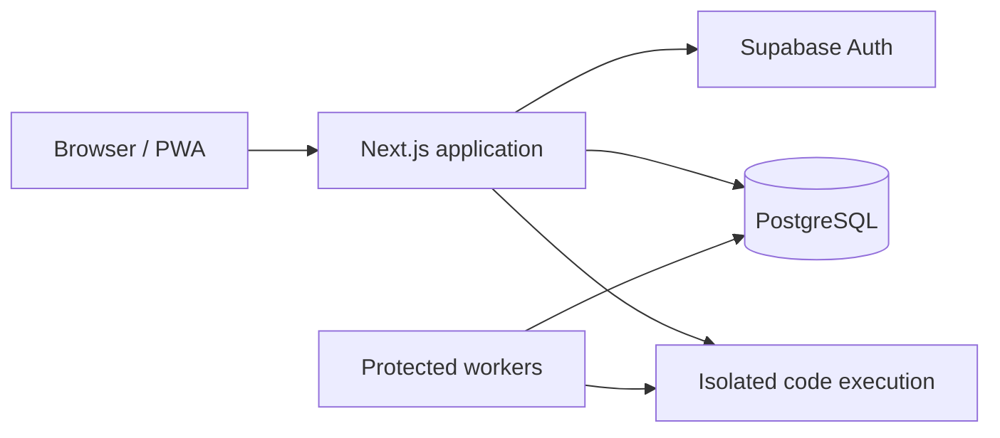

# Architecture

Method is a modular monolith: a Next.js web/API application, shared TypeScript
domain code, and PostgreSQL repositories. This document describes implemented
boundaries. Deployment settings and verification determine which integrations
are operational in a given environment.

## Components and responsibilities

| Component | Responsibility |
|---|---|
| apps/web/src/app | Learner, instructor, and administration routes; authenticated APIs and actions |
| apps/web/src/components | UI state, accessible controls, navigation, and learner workflows |
| apps/web/src/lib | Application services, evaluation, continuity, provider adapters, and server authorization |
| packages/domain | Framework-independent policies and contracts, including grade calculations and recommendation foundations |
| packages/database | Database client, repositories, append-only records, and node-pg-migrate migrations |
| packages/feature-flags | Feature-control foundations |
| packages/observability | Structured telemetry and correlation foundations |
| infra | Infrastructure definitions and modules; committed definitions do not prove a deployed environment |
| .github/workflows | Build, security, browser, worker, and health automation |

The managed runtime uses Vercel, Supabase Auth/Postgres, and Vercel Sandbox.
Local development uses the checked-in PostgreSQL Compose service. Judge0 remains
an optional execution adapter. The optional AI path is disabled by default;
deterministic evaluation remains the baseline.

## Identity and authorization

Supabase verifies signed-in identities and refreshes server cookies. Guests
have a separate HTTP-only guest identity. Guest-to-account merge is explicit.
Browser preferences and editable identity metadata cannot grant privileges.

Learner repositories enforce user/guest ownership for the concrete object.
Instructor classroom repositories enforce the authenticated class owner's ID.
Administration uses server-controlled role assignments and per-action permission
checks; instructor opt-in does not create an administration assignment. Every
protected page or mutation rechecks authorization regardless of visible links.

Browser database roles do not receive unrestricted repository access. Sensitive
tables use RLS and restricted grants, while privileged server connections still
enforce ownership in SQL. Audit events accompany role and class mutations.
Database failure never grants access.

## Practice and learning state

Versioned sessions and revisions preserve drafts, evaluation history, and
completion. Guarded browser storage buffers local work and supports guest use;
an offline cache is not proof of a server save. Account resume and merge code
must resolve ownership and revision conflicts without silently replacing work.

The practice route uses an immersive staged workspace rather than the global
sidebar. Its validated stage URL is view state, separate from persisted academic
workflow state. A local, client-loaded CodeMirror editor buffers bounded undo
state for the current owner/activity; a textarea supports loading or failure.
Session JSON optionally carries versioned per-language source drafts while the
active `code` and `language` remain compatible with existing execution contracts.
Payload limits and revision conflict comparisons cover inactive drafts too.
Legacy client saves retain existing inactive languages; a versioned reset can
explicitly replace the set without changing trusted verification records.
Editor navigation, layout preferences and manual continuation never establish
verification, a grade or learning evidence.

The deterministic evaluator uses activity-specific rubrics. Evaluation jobs
support polling, cancellation, retry accounting, and lease recovery. Runtime
selection can use PostgreSQL or instance-local memory; durable operation needs
the database mode and a configured protected worker trigger.

Profiles and concept reviews are persisted. Account learning estimates are a
separate projection from academic grades and device-only estimates. A private
outbox records eligible source changes atomically; authenticated owner reads
process a bounded batch and derive versioned concept estimates and explained
practice recommendations using the existing database and deterministic rules.

Released multiple-choice results, finalized personal diagnostic answers, and newly
captured practice verification supply evidence. Omitted answers supply no learning
observation. Logical questions deduplicate across versions and assignment copies;
practice activities deduplicate across sessions and retries. Limited evidence
produces broad model ranges, while unknown concepts remain unknown. Current
release, applicability, dispute, and personalization consent are checked before
evidence is exposed. Review dates use an independent durable projection, expected
revisions, and immutable retry receipts. These estimates never change gradebook
scores. No additional hosted worker or model provider is required for this flow.

Learning APIs return owner-scoped aggregate allowlists with private/no-store
headers. Class answer keys, private per-question scoring evidence, and instructor
notes remain server-only. Historical practice metadata is not sufficient provenance
for backfill; existing history remains visible, and newly guarded server captures add
evidence. Execution reports retain the coding harness's existing trust boundary.
Guest recommendations remain device-local. Personalization opt-out suppresses
account recommendations in favor of the standard curriculum.

Personal diagnostics use ten dedicated questions disjoint from the sixty-question
class-assignable catalog. One diagnostic per owner and selection version pins a
reviewed snapshot; private answer drafts use expected revisions and replayable
receipts. A final submission freezes saved answers, validates deterministic scoring
in PostgreSQL, and atomically queues eligible learning evidence. Only the owner can
read its post-submission answer explanations. Diagnostic work creates no class
recipient, grade revision, or publication. Opt-out preserves the personal work but
clears its learning projection; opting in can rebuild eligible submitted evidence.

Recommendation reads return an opaque decision key alongside the existing top
three activities. An explicit owner-guarded selection checks that key and current
eligibility before storing the complete versioned ranking inputs, alternatives,
and a retry receipt. Rendering or resizing the UI creates no selection. Detailed
decisions are bounded to the latest hundred per account; compact receipts survive
pruning so an old accepted retry cannot become another choice. A trusted later
verification can attach once to the latest matching selection within fourteen
days, without falling back to an older completed choice. This association records
an observed outcome and makes no causal claim. Opt-out deletes selection details
and receipts. These records are private server tables protected by RLS and revoked
browser-role grants.

## Classes and gradebook

Classes have server-generated enrollment codes, explicit ownership, assignments,
and enrolled learners. Authors can select a practice activity, compose an MCQ
quiz or write a rubric-based text/pseudocode assignment. Content-level practice
completion and assignment grades are distinct.

Class routes share role-aware navigation. The learner entry opens a sole active
enrolled class directly while preserving an explicit class-list/join route.
Assignments are filtered by class in the membership-scoped SQL read; the learner
overview does not combine work from unrelated classes. Learner People context is
limited to instructor display name and enrollment count, separate from staff
roster projections.

Class announcements use private server tables for stable identities, immutable
text revisions and command/publication history, plus monotonic per-learner read
state. Explicit publication pins the reviewed saved revision. Draft corrections
do not alter the current published text; archive removes its current visibility.
Learner reads expose only the published snapshot and publication sequence, with
no later draft state. A mark-read command pins the displayed publication, so a
delayed request cannot mark a newer correction read. Current role, owner/admin
authority, enrollment and class lifecycle are checked in repository transactions.
Author writes and their audit events commit together; actor-bound fingerprints
recover original command receipts. The additive schema keeps RLS enabled and
browser grants closed, validates reference lineage and preserves publication
history. Plain-text rendering escapes authored content; no notification provider,
rich-HTML processing or additional service is introduced.

The gradebook repository stores immutable published policy/content snapshots,
explicit recipients, assignment response revisions, grade revisions, publication
history, applicability changes, and grade-review events. It does not infer grades
from a learner's private practice. Published policies pin content, rubric or
verifier versions, maximum points, and attempt rules.

Class concept insights are read-only aggregates over current enrollment and
eligible released MCQ assessments. A repeatable-read transaction checks actor,
class ownership or the separate `classes.insights.read` capability, current score
publication, applicability and dispute state. Item correctness is recomputed from
the frozen publication and immutable submitted answers, rather than trusting
per-item result JSON. Latest eligible answered logical questions replace repeats;
a later skipped copy does not erase an earlier answered item. Manual corrections
without matching item evidence are excluded. Personal diagnostic, practice and
account-learning projections are never queried for class reports.

Owner views expose class-level observed correctness and coverage. Administrator
views suppress every numeric concept field below five distinct answered learners.
Ranking and follow-up selection consume this sanitized report, preventing hidden
statistics from influencing default focus, ordering or reasons. APIs explicitly
project aggregates and safe question previews; they return no learner identities,
individual responses, private notes or answer keys. This introduces no broader
gradebook permission and requires no new table or service.

Follow-up proposals select at most six unused reviewed nonadvanced logical items
for up to three concepts. Public curriculum identifiers enter the authoring URL;
the server rechecks scope and computes an editable seed. Stable owner/class/focus
browser keys isolate this work from unrelated new drafts and retain original
requests across source changes. A proposal creates nothing until the author
explicitly saves through the existing draft repository. Publication retains its
existing frozen audience, revision, receipt and grade-release contracts.

Points use integer hundredths. Totals use published numeric outcomes and expose
coverage; ranking requires a comparable finalized assignment set. Excused work
changes a learner's denominator. An active dispute keeps the published score
visible while excluding the learner from comparable ranking.

Learners see their own published results, public feedback, and review history.
Draft scores and private instructor notes remain private. Instructor principals
enforce class ownership. A separate administrator principal requires current
active `classes.manage` authority inside the repository transaction; a user role
label alone grants no global gradebook scope. Publication and correction use expected revisions, recipient locks, and
idempotency keys. A newer submission remains pending even when an older published
grade is available in history.

Assignment-wide releases validate an explicitly reviewed target list against
current enrollment, applicability, dispute state, latest attempts, saved grades
and publication sequences. Parent/recipient locks and one transaction make each
batch atomic. Actor-bound command fingerprints retain original publication
receipts; role revocation is checked before recovery. Batches are bounded to 500
targets and never silently truncate an audience.

Named class results use a separate append-only sharing/revocation history. Targets
reference exact released grades, publications and submitted attempts; no copied
names or answer payloads enter the sharing ledger. Learner reads require current
class enrollment and eligible matching records, expose no email/private notes/
feedback/answer keys, and load full responses only on demand. A sharing-version
receipt prevents combining an old roster with a newly shared response. Withdrawal,
excusal, new work or corrections suppress affected disclosures until explicitly
reshared. Reference deletion follows account/class cascades. All new tables keep
RLS enabled and browser-role grants closed; invoker lineage guards protect the
references. Frozen legacy practice content is displayed as stored, without
substituting a mutable current catalog for historical assignment questions.

Manual rubric grades require every published criterion. Missing-work zeros
require an explicit elapsed closing time and attributable instructor action.
Verified-completion results come from the trusted worker and pinned test suite;
the learner cannot submit a pass flag, hidden tests, or grade identifiers.

The latest completed practice verification is stored separately from editable
workspace state in the account/guest-owned session metadata. A server-generated
request marker orders runs; stale completions cannot replace a newer request.
The report, submitted source/language, completion state, and initial review
schedule commit transactionally before a successful response. Autosave cannot
overwrite the protected report. Read projections restore matching results and
keep later code edits unverified. This latest-report snapshot is separate from
the immutable assignment gradebook history.

Workspace identity is resolved on the server before opening owner-scoped caches.
Save requests carry an expected owner, draft revision, and request identity; these
are consistency checks alongside server authentication and row ownership.
Session starts serialize by owner/content, and revision allocation runs under the
owned session row lock. Bounded server receipts make recent retries idempotent;
older stale retries fail revision checks. The browser serializes saves, retains
unacknowledged requests across reload, and preserves both versions of a conflict.
Draft revision numbers are distinct from the session counter advanced by verification.

Assessment drafts use separate private PostgreSQL tables for mutable authoring
state and immutable save receipts. Both instructor and administrator entry points
use the same service: current class-management permission, class scope, expected
author, and revision checks apply before mutations or receipt replay. Drafts store
ordered question-version references and integer point units; they contain no
answer keys and create no learner recipients or grades. Browser draft recovery is
scoped to the verified author and retains an alternate copy across reload.

Quiz duplication copies a saved draft revision into a fresh private draft. Source
and destination class authority are checked independently inside one transaction,
with class parents locked in a stable order before the source draft. First
execution requires the expected source revision and currently reviewed exact
question versions; it preserves ordered references, integer points and authored
instructions while clearing dates. An unavailable version requires explicit
source repair. Copies do not inherit publication, audience, attempts or grades.

Copy commands share the draft mutation advisory-lock and immutable receipt
namespace with create/update commands. The fingerprint binds source, destination
and expected revision. After rechecking access, a retry recovers the original
receipt before checking later source edits or catalog retirement. Copy audits
record identifiers/counts, not authored text or learner records. HTTP input is
byte-bounded, rejects duplicate/unknown fields and requires the verified actor;
responses allowlist class metadata and public question projections. Owner-bound
preview checks hide stale browser data on revalidation and preserve uncertain
commands. The workflow uses existing tables and introduces no migration or worker.

Reusable templates use creator-owned heads, immutable content versions and
immutable mutation receipts in separate private tables. This keeps reusable
content independent of class-bound drafts, schedules and publication history.
The additive migration enables RLS and revokes browser/PUBLIC table and helper
access; privileged server SQL still checks current roles and creator ownership.
Administrator class-management authority does not override template ownership.

Capturing a saved draft checks its concrete class and expected revision. Content
stores title, authored instructions, ordered question-version references and exact
integer points; class/source identifiers occur only in audit metadata. Templates
stand independently after capture. Editing appends a version and advances the
head revision, while archive/restore advances lifecycle state without changing
content history. The database fixes ownership, validates the current-version
reference and rejects direct version/receipt mutation.

Using a pinned template version rechecks creator ownership and destination class
scope before creating a normal private draft with dates cleared. It shares the
existing draft advisory lock/receipt namespace, preventing cross-operation key
reuse. Template mutations have their own serialized immutable receipts. Replays
reauthorize access before recovering the original outcome, then bypass new
revision/lifecycle/catalog checks; current revision metadata protects comparison
with newer state. Parent locks precede dependent template/draft locks.

The library is owner-filtered and paginated. Historical previews and editing use
safe question projections; no answer keys, enrollment records or grades enter the
template DTO. Owner-bound browser checks hide stale data during revalidation and
preserve unsaved content and exact pending commands. Apply the additive migration
before dependent queries. Application rollback can retain the new tables; after
templates are used, preserve their history and recover with a forward fix.

The sixty-question class-assignable multiple-choice catalog is server-owned,
explicitly versioned, and records original provenance plus automated
author/reviewer separation. The client
receives an allowlisted question projection without keys, explanations, or
misconception tags. Immutable scoring snapshots pin reviewed versions and use
exact integer point arithmetic. Catalog review does not imply teacher validation.

Explicit quiz publication creates a class-private content/version placeholder,
immutable scoring snapshot, frozen recipient cohort, grade policy, and request
receipt in one transaction. Generic content reads exclude class-private rows.
Quiz joins do not backfill recipients; gradebook readers distinguish intentionally
unassigned learners from missing records within the published cohort.

Recipient-owned answer drafts use optimistic revisions and replayable receipts.
One final submission atomically writes the typed answers, immutable attempt,
deterministic scoring evidence, and private grade revision. Database constraints
validate the score against the pinned snapshot. Current roles, ownership,
enrollment, applicability, and admission times govern new work; accepted retries
recheck access without creating another attempt. The existing instructor release
ledger publishes scores to both gradebooks. MCQ scoring uses no execution worker
or paid model, and learner responses omit keys and unreleased scores.

Quiz HTTP commands use bounded UTF-8 decoding, reject duplicate JSON keys, and
allowlist client fields. Expected actor headers protect open tabs after account
changes. Navigation readiness from pseudocode is separately computed from current
text; manual continuation does not mark verified completion or award a grade.

Written assessments have private draft, frozen publication, response-draft and
request-receipt storage. Publication pins the authored prompt, ordered rubric,
exact-point policy, dates and independently checked enrolled audience. Generic
content contains a class-private placeholder; authored content remains in private
storage. Administrator class authoring does not grant instructor grade access.

Owner-scoped text saves use revisions and immutable original receipts. A final
submission freezes the exact saved text once into the existing gradebook attempt
ledger. The generic code-submission path rejects these recipients. The existing
rubric grade and explicit-release ledgers handle review, corrections and disputes;
no parallel scoring store, model grader or worker is added. Pending review stays
pending and never becomes an inferred zero or conceptual weakness.

All written HTTP operations authenticate before decoding and require the original
actor header. Byte-bounded unique-key JSON decoding, strict field contracts and
nested output projections protect both account and content scope. Current roles,
class/enrollment/recipient authority precede receipt replay; new work separately
requires current applicability and admission time. Accepted receipts survive later
closing/excusal. Excused reads expose only a metadata shell for owner-verified
pending-command recovery; prompt, rubric, responses and grades remain hidden.
Opening times likewise withhold content. RLS and revoked browser/helper privileges
supplement explicit server authorization. Apply the additive migration before
dependent queries; retain used content/history and recover with a forward fix.

## Code execution and queues

Python 3, C++20, TypeScript and Java verification use server-owned activity tests.
Private suites and execution harnesses are server-only modules. The isolated
process reports actual outputs; the server compares them against expectations.
Practice **Run** shares the execution quota but executes only public/custom cases
and never writes verification, completion, learning evidence or an academic
attempt. **Submit** uses the full suite and the existing source-bound durable
verification flow. Existing saved grade versions remain readable.
Versioned custom-case drafts use bounded workspace metadata and participate in
owner-scoped save/conflict/recovery, including preservation when older tabs save.
Stateful class activities share a typed public operation-trace contract. Fixed
server-owned dispatch creates a fresh instance for every trace and normalizes
constructor/void results to `null`; operation names, arities, values, chronology
and bounds are validated before source generation. Private traces and expectations
remain outside the learner-facing modules and comparison still occurs on the server.
The original ten-item diagnostic/MCQ catalog stays explicitly separated from the
expanded coding catalog, so adding coding activities cannot silently change its
frozen coverage baseline.
Vercel Sandbox executes code in ephemeral microVMs with network access denied
and bounded process time/output. Learner code never executes directly in the
ordinary application process. Provider credentials remain server-only.
An optional server-only `VERCEL_SANDBOX_SNAPSHOT_ID` selects an existing trusted
toolchain snapshot for every execution. Snapshot runs retain denied network access,
ephemeral lifecycle and the same resource limits. Invalid or inaccessible configured
snapshots fail without falling back to a different image. Compiler installation,
snapshot preparation and verification happen separately from learner execution.
Trusted snapshots must contain no credentials, learner work or private data;
setting the ID alone does not prove that any compiler is available.

Assignment verification has its own durable leased queue. Creating an attempt
and its job is transactional. Lease tokens protect completion and retries from
stale workers; only the current eligible attempt can produce the current result.
Practice execution and reasoning evaluation have separate queue boundaries.
Expensive routes support quotas, backpressure, and failure states rather than
silently treating provider unavailability as a learner failure.

Evaluation and execution completion/failure writes require the claimed attempt
generation and return a persistence acknowledgement. A stale worker cannot finish
a reclaimed run. Workers close stores they create; uncertain external execution
is not replayed automatically during recovery.

## Data and API conventions

Repositories own transactions and object-level authorization. Validate external
inputs, make retried mutations idempotent, and return optimistic conflicts for
stale writes. Published content and grading evidence retain exact versions.
Use additive migrations and separately reviewed destructive changes.
Apply pending node-pg-migrate migrations before running code that reads diagnostic
or recommendation-selection storage. Once these sources or receipts are in use,
preserve them through a forward migration; the migrations reject reversal that
would discard used learning records.

Server errors and queue health expose privacy-bounded context and correlation
IDs. Exclude raw submissions, personal notes, emails, tokens, and cookies from
logs. Auth secrets, database connections, and worker credentials are never public
client configuration. Production data does not belong in preview/local fixtures.

## Decisions and tradeoffs

- A modular monolith keeps deployment and transactions manageable while shared
  domain modules preserve boundaries for later changes.
- PostgreSQL stores application state and durable jobs, avoiding a required
  additional queue service; workers and scheduling still need operating evidence.
- Deterministic rubrics and trusted tests make results reproducible. They cover
  authored activities and do not establish general semantic grading.
- Append-only grading records cost more storage and require explicit projections,
  but preserve corrections, disputes, and exact published evidence.
- Local buffers keep guest/offline work usable while requiring explicit sync,
  ownership, and conflict handling for account continuity.

See [usage](USAGE.md) for setup and supported workflows and
[conventions](CONVENTIONS.md) for implementation, validation, and release rules.
