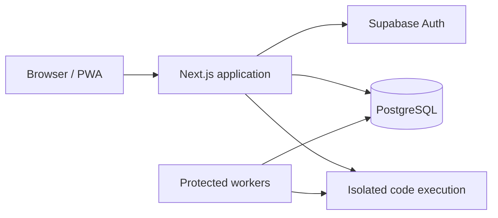

# Architecture

Method is a modular monolith: a Next.js web/API application, shared TypeScript
domain code, and PostgreSQL repositories. This document describes implemented
boundaries. Deployment settings and verification determine which integrations
are operational in a given environment.

## Components and responsibilities

| Component | Responsibility |
|---|---|
| apps/web/src/app | Learner, instructor, and administration routes; authenticated APIs and actions |
| apps/web/src/components | UI state, accessible controls, navigation, and learner workflows |
| apps/web/src/lib | Application services, evaluation, continuity, provider adapters, and server authorization |
| packages/domain | Framework-independent policies and contracts, including grade calculations and recommendation foundations |
| packages/database | Database client, repositories, append-only records, and node-pg-migrate migrations |
| packages/feature-flags | Feature-control foundations |
| packages/observability | Structured telemetry and correlation foundations |
| infra | Infrastructure definitions and modules; committed definitions do not prove a deployed environment |
| .github/workflows | Build, security, browser, worker, and health automation |

The managed runtime uses Vercel, Supabase Auth/Postgres, and Vercel Sandbox.
Local development uses the checked-in PostgreSQL Compose service. Judge0 remains
an optional execution adapter. The optional AI path is disabled by default;
deterministic evaluation remains the baseline.

## Identity and authorization

Supabase verifies signed-in identities and refreshes server cookies. Guests
have a separate HTTP-only guest identity. Guest-to-account merge is explicit.
Browser preferences and editable identity metadata cannot grant privileges.

Learner repositories enforce user/guest ownership for the concrete object.
Instructor classroom repositories enforce the authenticated class owner's ID.
Administration uses server-controlled role assignments and per-action permission
checks; instructor opt-in does not create an administration assignment. Every
protected page or mutation rechecks authorization regardless of visible links.

Browser database roles do not receive unrestricted repository access. Sensitive
tables use RLS and restricted grants, while privileged server connections still
enforce ownership in SQL. Audit events accompany role and class mutations.
Database failure never grants access.

## Practice and learning state

Versioned sessions and revisions preserve drafts, evaluation history, and
completion. Guarded browser storage buffers local work and supports guest use;
an offline cache is not proof of a server save. Account resume and merge code
must resolve ownership and revision conflicts without silently replacing work.

The practice route uses an immersive staged workspace rather than the global
sidebar. Its validated stage URL is view state, separate from persisted academic
workflow state. A local, client-loaded CodeMirror editor buffers bounded undo
state for the current owner/activity; a textarea supports loading or failure.
Session JSON optionally carries versioned per-language source drafts while the
active `code` and `language` remain compatible with existing execution contracts.
Payload limits and revision conflict comparisons cover inactive drafts too.
Legacy client saves retain existing inactive languages; a versioned reset can
explicitly replace the set without changing trusted verification records.
Editor navigation, layout preferences and manual continuation never establish
verification, a grade or learning evidence.

The deterministic evaluator uses activity-specific rubrics. Evaluation jobs
support polling, cancellation, retry accounting, and lease recovery. Runtime
selection can use PostgreSQL or instance-local memory; durable operation needs
the database mode and a configured protected worker trigger.

Profiles and concept reviews are persisted. Account learning estimates are a
separate projection from academic grades and device-only estimates. A private
outbox records eligible source changes atomically; authenticated owner reads
process a bounded batch and derive versioned concept estimates and explained
practice recommendations using the existing database and deterministic rules.

Released multiple-choice results and newly captured practice verification supply
evidence. Logical questions deduplicate across versions and assignment copies;
practice activities deduplicate across sessions and retries. Limited evidence
produces broad model ranges, while unknown concepts remain unknown. Current
release, applicability, dispute, and personalization consent are checked before
evidence is exposed. Review dates use an independent durable projection, expected
revisions, and immutable retry receipts. These estimates never change gradebook
scores. No additional hosted worker or model provider is required for this flow.

Learning APIs return owner-scoped aggregate allowlists with private/no-store
headers. Answer keys, per-question scoring evidence, and private instructor notes
remain server-only. Historical practice metadata is not sufficient provenance for
backfill; existing history remains visible, and newly guarded server captures add
evidence. Execution reports retain the coding harness's existing trust boundary.
Guest recommendations remain device-local. Personalization opt-out suppresses
account recommendations in favor of the standard curriculum.

## Classes and gradebook

Classes have server-generated enrollment codes, explicit ownership, assignments,
and enrolled learners. Current assignment authoring selects an existing practice
activity. Content-level practice completion and assignment grades are distinct.

The gradebook repository stores immutable published policy/content snapshots,
explicit recipients, assignment response revisions, grade revisions, publication
history, applicability changes, and grade-review events. It does not infer grades
from a learner's private practice. Published policies pin content, rubric or
verifier versions, maximum points, and attempt rules.

Points use integer hundredths. Totals use published numeric outcomes and expose
coverage; ranking requires a comparable finalized assignment set. Excused work
changes a learner's denominator. An active dispute keeps the published score
visible while excluding the learner from comparable ranking.

Learners see their own published results, public feedback, and review history.
Draft scores and private instructor notes remain private. Instructor queries
enforce class ownership; the gradebook has no implicit global-administrator
scope. Publication and correction use expected revisions, recipient locks, and
idempotency keys. A newer submission remains pending even when an older published
grade is available in history.

Manual rubric grades require every published criterion. Missing-work zeros
require an explicit elapsed closing time and attributable instructor action.
Verified-completion results come from the trusted worker and pinned test suite;
the learner cannot submit a pass flag, hidden tests, or grade identifiers.

The latest completed practice verification is stored separately from editable
workspace state in the account/guest-owned session metadata. A server-generated
request marker orders runs; stale completions cannot replace a newer request.
The report, submitted source/language, completion state, and initial review
schedule commit transactionally before a successful response. Autosave cannot
overwrite the protected report. Read projections restore matching results and
keep later code edits unverified. This latest-report snapshot is separate from
the immutable assignment gradebook history.

Workspace identity is resolved on the server before opening owner-scoped caches.
Save requests carry an expected owner, draft revision, and request identity; these
are consistency checks alongside server authentication and row ownership.
Session starts serialize by owner/content, and revision allocation runs under the
owned session row lock. Bounded server receipts make recent retries idempotent;
older stale retries fail revision checks. The browser serializes saves, retains
unacknowledged requests across reload, and preserves both versions of a conflict.
Draft revision numbers are distinct from the session counter advanced by verification.

Assessment drafts use separate private PostgreSQL tables for mutable authoring
state and immutable save receipts. Both instructor and administrator entry points
use the same service: current class-management permission, class scope, expected
author, and revision checks apply before mutations or receipt replay. Drafts store
ordered question-version references and integer point units; they contain no
answer keys and create no learner recipients or grades. Browser draft recovery is
scoped to the verified author and retains an alternate copy across reload.

The starter multiple-choice catalog is server-owned, explicitly versioned, and
records original provenance plus automated author/reviewer separation. The client
receives an allowlisted question projection without keys, explanations, or
misconception tags. Immutable scoring snapshots pin reviewed versions and use
exact integer point arithmetic. Catalog review does not imply teacher validation.

Explicit quiz publication creates a class-private content/version placeholder,
immutable scoring snapshot, frozen recipient cohort, grade policy, and request
receipt in one transaction. Generic content reads exclude class-private rows.
Quiz joins do not backfill recipients; gradebook readers distinguish intentionally
unassigned learners from missing records within the published cohort.

Recipient-owned answer drafts use optimistic revisions and replayable receipts.
One final submission atomically writes the typed answers, immutable attempt,
deterministic scoring evidence, and private grade revision. Database constraints
validate the score against the pinned snapshot. Current roles, ownership,
enrollment, applicability, and admission times govern new work; accepted retries
recheck access without creating another attempt. The existing instructor release
ledger publishes scores to both gradebooks. MCQ scoring uses no execution worker
or paid model, and learner responses omit keys and unreleased scores.

Quiz HTTP commands use bounded UTF-8 decoding, reject duplicate JSON keys, and
allowlist client fields. Expected actor headers protect open tabs after account
changes. Navigation readiness from pseudocode is separately computed from current
text; manual continuation does not mark verified completion or award a grade.

## Code execution and queues

Python 3, C++20, and TypeScript verification use server-owned activity tests.
Vercel Sandbox executes code in ephemeral microVMs with network access denied
and bounded process time/output. Learner code never executes directly in the
ordinary application process. Provider credentials remain server-only.

Assignment verification has its own durable leased queue. Creating an attempt
and its job is transactional. Lease tokens protect completion and retries from
stale workers; only the current eligible attempt can produce the current result.
Practice execution and reasoning evaluation have separate queue boundaries.
Expensive routes support quotas, backpressure, and failure states rather than
silently treating provider unavailability as a learner failure.

Evaluation and execution completion/failure writes require the claimed attempt
generation and return a persistence acknowledgement. A stale worker cannot finish
a reclaimed run. Workers close stores they create; uncertain external execution
is not replayed automatically during recovery.

## Data and API conventions

Repositories own transactions and object-level authorization. Validate external
inputs, make retried mutations idempotent, and return optimistic conflicts for
stale writes. Published content and grading evidence retain exact versions.
Use additive migrations and separately reviewed destructive changes.

Server errors and queue health expose privacy-bounded context and correlation
IDs. Exclude raw submissions, personal notes, emails, tokens, and cookies from
logs. Auth secrets, database connections, and worker credentials are never public
client configuration. Production data does not belong in preview/local fixtures.

## Decisions and tradeoffs

- A modular monolith keeps deployment and transactions manageable while shared
  domain modules preserve boundaries for later changes.
- PostgreSQL stores application state and durable jobs, avoiding a required
  additional queue service; workers and scheduling still need operating evidence.
- Deterministic rubrics and trusted tests make results reproducible. They cover
  authored activities and do not establish general semantic grading.
- Append-only grading records cost more storage and require explicit projections,
  but preserve corrections, disputes, and exact published evidence.
- Local buffers keep guest/offline work usable while requiring explicit sync,
  ownership, and conflict handling for account continuity.

See [usage](USAGE.md) for setup and supported workflows and
[conventions](CONVENTIONS.md) for implementation, validation, and release rules.
